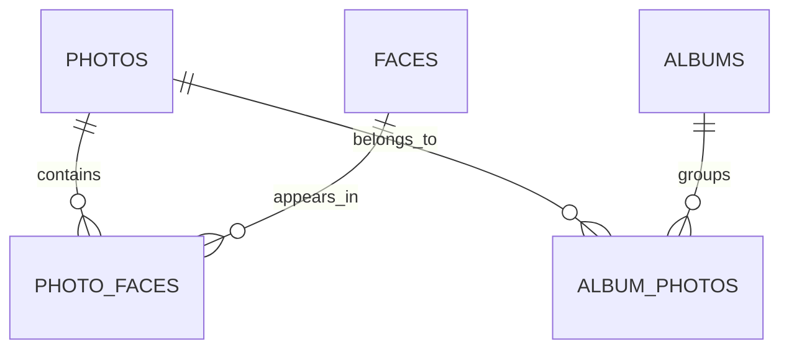

<div align="center">


# Umbela Server

**Self-hosted, zero-knowledge photo and media vault with private face recognition, served exclusively over Tor.**

A sovereign alternative to Google Photos and Apple Photos, where your memories, your metadata and your biometrics never leave your control.


</div>

---

## What is Umbela?

Umbela is a **self-hosted digital asset management platform**, media catalog and face recognition system built around a **Zero-Knowledge** and **Privacy-First** architecture.

Personal data, spatiotemporal metadata, biometric embeddings and search indexes all stay **end-to-end encrypted and fully under your control**, even while travelling across public networks.

No cloud. No open ports. No public DNS. No trust required in the host.

## Highlights

| Feature | Description |
|---|---|
| **Zero-Knowledge at rest** | Config, session tokens and persistent internal state are stored encrypted. The server holds no keys until you provide your passphrase. |
| **In-memory isolation** | Secrets (session keys, Ed25519 private keys, master keys) are never written to disk in plaintext. |
| **Tor-native** | Umbela launches and controls a Tor daemon that publishes a v3 Hidden Service automatically. Reachable only through Tor. |
| **Private face recognition** | Face embeddings and person profiles live inside your encrypted vault, never in a third party's cloud. |
| **Single binary** | Written in Go with a minimal attack surface. It only needs libvips, OpenSSL and the `tor` executable, which the packages install for you. |
| **Fast, reliable storage** | SQLite in WAL mode with Bun ORM, tuned for concurrent reads and atomic transactions. |

## Installation

Download the file for your system from the [**Releases**](../../releases) page. Pick `amd64` for regular PCs and Intel Macs, and `arm64` for Apple Silicon, Raspberry Pi 3/4/5 and other ARM 64-bit machines.

### Linux

The packages install the `umbela` command system-wide and pull in everything it needs (libvips, OpenSSL and Tor) automatically.

| Distribution | File | Install |
|---|---|---|
| Debian, Ubuntu, Raspberry Pi OS (64-bit) | `.deb` | `sudo apt install ./umbela_*.deb` |
| Fedora | `.rpm` | `sudo dnf install ./umbela-*.rpm` |
| Arch Linux | `.pkg.tar.zst` | `sudo pacman -U ./umbela-*.pkg.tar.zst` |

Use `apt install ./file.deb` rather than `dpkg -i`, which does not download dependencies.

> **Raspberry Pi:** 64-bit Raspberry Pi OS is supported. The 32-bit (`armv7`) system is not.

The packages also install the ONNX Runtime library used for face recognition in `/usr/lib/umbela`.

If you prefer the plain download (`umbela-cli-linux-<arch>.tar.gz`), install libvips, OpenSSL and Tor (the `tor` package) with your package manager, then:

```bash
tar -xzf umbela-cli-linux-amd64.tar.gz
sudo mv umbela /usr/local/bin/
sudo mkdir -p /usr/local/lib/umbela
sudo mv libonnxruntime.so.* /usr/local/lib/umbela/
```

### macOS

1. Install [Homebrew](https://brew.sh), the image library and Tor:

   ```bash
   brew install vips tor
   ```

2. Extract the archive and move the files into place:

   ```bash
   tar -xzf umbela-cli-darwin-arm64.tar.gz
   sudo mv umbela /usr/local/bin/
   # Apple Silicon only: the library used for face recognition
   sudo mkdir -p /usr/local/lib/umbela
   sudo mv libonnxruntime.*.dylib /usr/local/lib/umbela/
   ```

3. The files are not signed or notarized yet. If macOS blocks them after a browser download, remove the quarantine flag:

   ```bash
   sudo xattr -dr com.apple.quarantine /usr/local/bin/umbela /usr/local/lib/umbela
   ```

> **Intel Macs:** the server works, but face recognition is not available, because ONNX Runtime does not publish a macOS Intel build.

### Windows

Download `umbela-cli-windows-amd64.zip` and extract it to a folder of your choice, for example `C:\Umbela`. Everything it needs (Tor, the image libraries and the face recognition library) is inside, so there is nothing else to install.

Open a terminal in that folder and run it:

```powershell
cd C:\Umbela
.\umbela.exe create
```

To run `umbela` from any folder, add that folder to your `PATH`. Your data is kept in `C:\Users\<you>\.umbela`.

> The program is not signed yet, so Windows SmartScreen may show "Windows protected your PC". Choose **More info** and then **Run anyway**. Antivirus software may also warn about it because it starts Tor; the source code and the build are public in this repository.

Keep `umbela.exe` together with the other files of the zip: it looks for `tor\tor.exe`, `data\` and the DLLs next to itself.

### Building from source

You need Go (the version in `go.mod`), a C compiler, `pkg-config`, and the libvips and OpenSSL development packages (`libvips-dev libssl-dev` on Debian, `vips-devel openssl-devel` on Fedora, `libvips openssl` on Arch, `brew install vips pkgconf` on macOS).

```bash
CGO_ENABLED=1 go build -o umbela ./cmd/umbela-cli
```

Face recognition also needs the [ONNX Runtime](https://github.com/microsoft/onnxruntime/releases) shared library, version 1.31.0 exactly. Point `UMBELA_ORT_LIB` to it, or the server will start with face recognition turned off.

## Getting Started

After installing, run the following commands from a terminal.

### 1. Create your Vault

```bash
umbela create
```

Initializes a new encrypted Vault. You will be asked for a passphrase.

### 2. Add your photos

```bash
umbela add <username> <path-to-images>
```

The path can be a folder of regular images or a **Google Takeout ZIP** export. Both are supported.

```bash
# Regular images
umbela add alice ~/Pictures/vacation

# Google Takeout ZIP
umbela add alice ~/Downloads/takeout-20260101.zip
```

### 3. Pair your phone

```bash
umbela pair <username>
```

Pairs your phone with your Umbela server.

### 4. Start the server

```bash
umbela start <username> 
```

Unlocks the Vault in RAM, starts the Tor daemon and brings your private `.onion` service online.

> **Note:** the first start can take up to 10 minutes (usually 1-3, longer on slow connections or a Raspberry Pi). Your server must first connect to the Tor network, build its circuits and publish its `.onion` address. Until that finishes, your phone will not be able to connect. If pairing fails right after starting, wait a minute and try again.


## Architecture and Design Principles

Umbela is built in **Go** around a minimal attack surface, a strictly static executable and a **Zero-Trust System/Host** threat model.

### Zero-Knowledge at Rest
All configuration artifacts, session tokens and persistent internal state are stored encrypted. A server at rest cannot inspect the database or file system unless the user supplies their passphrase.

### In-Memory Isolation
No sensitive secret is ever persisted in plaintext. Temporary network and socket operations live exclusively on **RAM-backed filesystems** (`tmpfs`, mode `0700`), which are destroyed and wiped when the process terminates.

### Native Onion Connectivity (Offline-First and Tor-Native)
The server embeds and manages a Tor daemon at the system level. Every instance automatically generates a **Hidden Service v3**, reachable only through the Tor network. That eliminates the need for:

- Port forwarding
- Public DNS records
- Reverse proxies exposed to the internet

```
┌──────────────┐        Tor network        ┌───────────────────────────────┐
│   Your       │ ───────────────────────▶ │  Umbela                       │
│   client     │   (.onion v3, E2E enc.)   │  ┌─────────┐   ┌────────────┐ │
└──────────────┘                           │  │ Embedded│   │ Encrypted  │ │
                                           │  │   Tor   │──▶│ Vault + DB │ │
                                           │  └─────────┘   └────────────┘ │
                                           │      RAM-only (tmpfs 0700)    │
                                           └───────────────────────────────┘
```

## Cryptography and Security Layer

| Concern | Primitive | Details |
|---|---|---|
| **Key derivation** | **Argon2id** | High-resistance parameters against brute force and ASIC/GPU acceleration. |
| **Salting / entropy** | `crypto/rand` | Salted master keys generated from cryptographically secure entropy. |
| **Symmetric encryption** | **AES-256-GCM** | Protects configuration (`config.bin`) and sensitive data volumes with authenticated encryption (AEAD). |
| **Network identity** | **Ed25519** (64 bytes) | Private key for the `.onion` service, stored inside the Vault's encrypted container. |
| **RAM hygiene** | `CleanBytes` | Explicit byte overwriting to prevent sensitive memory leakage before Go's garbage collector reclaims it. |

## Data Schema and Persistence

Metadata is managed through **Bun ORM** on top of **SQLite** running in **WAL (Write-Ahead Logging)** mode, optimized for concurrent reads and transactional atomicity.

### Relational Model (M2M)

| Entity | Table | Purpose |
|---|---|---|
| **Photo** | `photos` | Core entity: deduplication hashes, storage paths, capture timestamps (Unix UTC), geographic coordinates, Blurhash for progressive rendering, and EXIF metadata vectors. |
| **Face** | `faces` | Detected face profiles, linking person identifiers to high-dimensional biometric embeddings. |
| **PhotoFace** | `photo_faces` | Many-to-many pivot between photos and faces. Stores the bounding box (`bbox_min_x`, `bbox_min_y`, `bbox_max_x`, `bbox_max_y`) and detection confidence. |
| **Album** | `albums` | Logical groupings of images with dynamic covers and user metadata. |
| **AlbumPhoto** | `album_photos` | Many-to-many pivot linking photos and albums via composite primary keys based on UUID/Text. |



## Project Structure

```text
.
├── cmd
│   ├── umbela-cli              # Command-line entry point
│   │   ├── cmd
│   │   │   ├── add.go          # `umbela add`: import images / Takeout ZIPs
│   │   │   ├── create.go       # `umbela create`: initialize a new Vault
│   │   │   ├── errors.go
│   │   │   ├── middleware.go
│   │   │   ├── pair.go         # `umbela <username> pair`: pair a phone
│   │   │   ├── root.go         # Cobra root command
│   │   │   └── start.go        # `umbela <username> start`: run the server
│   │   └── main.go
│   └── umbela-desktop
├── go.mod
├── go.sum
├── internal
│   ├── api
│   │   ├── interceptors
│   │   ├── pb                  # Generated Protocol Buffers code
│   │   ├── proto
│   │   │   └── v1
│   │   │       ├── auth.proto
│   │   │       └── photo.proto
│   │   └── server
│   ├── auth
│   │   ├── key_agent.go
│   │   └── session.go
│   ├── config
│   │   ├── config.go
│   │   └── helpers.go
│   ├── crypto
│   │   ├── aes.go              # AES-256-GCM
│   │   ├── argon2.go           # Argon2id key derivation
│   │   ├── clean_bytes.go      # RAM hygiene (CleanBytes)
│   │   ├── hmac_sha256.go
│   │   └── salt.go
│   ├── db
│   │   ├── database.go
│   │   ├── errors.go
│   │   └── test_database.go
│   ├── image
│   │   ├── processor.go
│   │   └── processor_test.go
│   ├── models
│   │   ├── album.go
│   │   └── photo.go
│   ├── pipeline
│   │   └── legacy.go
│   ├── storage
│   │   ├── album_repo.go
│   │   └── photo_repo.go
│   ├── tor
│   │   └── controller.go       # Embedded Tor / Hidden Service control
│   └── vault
│       ├── config.go
│       ├── errors.go
│       ├── find.go
│       ├── open.go
│       └── vault.go
├── README.md
└── STEPS.md
```

| Path | Responsibility |
|---|---|
| `cmd/umbela-cli` | Cobra-based CLI: `create`, `add`, `pair` and `start`. |
| `internal/api` | Protocol Buffers definitions (`auth`, `photo`), generated code, server and interceptors. |
| `internal/auth` | Session handling and key agent. |
| `internal/crypto` | Argon2id, AES-256-GCM, HMAC-SHA256, salt generation and memory sanitization. |
| `internal/vault` | Vault lifecycle: creation, discovery, unlocking and encrypted configuration. |
| `internal/db` and `internal/storage` | SQLite (WAL) access and the photo/album repositories. |
| `internal/models` | Bun ORM models. |
| `internal/image` | Image processing for imported media. |
| `internal/tor` | Embedded Tor daemon and Hidden Service v3 controller. |

## Command-Line Interface

Umbela uses [Cobra](https://github.com/spf13/cobra) for a structured, modular and extensible CLI.

```text
umbela [command] [flags]

Main commands:
  create                      Initializes a new Vault: derives the KEK,
                              generates the Ed25519 network keys and creates
                              the encrypted database.
  add <username> <path>       Imports images or a Google Takeout ZIP into the Vault.
  pair <username>             Pairs a phone with the server.
  start <username>            Unlocks the Vault in RAM, starts the Tor controller
                              and exposes the server API.
```

## Tech Stack

| Layer | Technology |
|---|---|
| **Language** | [Go](https://go.dev/) |
| **CLI framework** | [Cobra](https://github.com/spf13/cobra) |
| **ORM** | [Bun](https://github.com/uptrace/bun) |
| **Database** | SQLite3 (CGO/shim driver, WAL mode, `SQLiteSharedMemory`) |
| **Networking and anonymization** | [Bine](https://github.com/cretz/bine) driving the system `tor` executable |
| **Cryptography** | [`golang.org/x/crypto`](https://pkg.go.dev/golang.org/x/crypto) (Argon2, AES-GCM, Ed25519) |

## Contributing

Contributions, issues and feature requests are welcome.

1. Fork the project
2. Create your feature branch (`git checkout -b feature/amazing-feature`)
3. Commit your changes (`git commit -m 'Add amazing feature'`)
4. Push to the branch (`git push origin feature/amazing-feature`)
5. Open a Pull Request

If you find a **security vulnerability**, please do not open a public issue. Report it privately to the maintainers instead.

## License

Distributed under the [GNU Affero General Public License v3.0](LICENSE) (AGPL-3.0-only).

---

<div align="center">

**Your photos. Your keys. Your network.**

</div>
